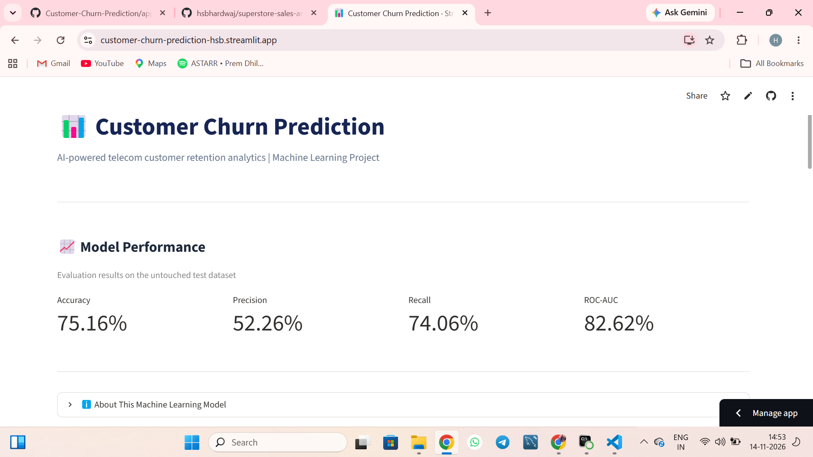
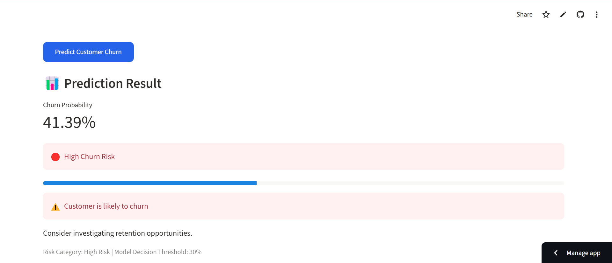

# Telecom Customer Churn Prediction

A Machine Learning project that predicts whether a telecom customer is likely to leave a company using customer demographics, subscription details, service usage and billing information.

The project includes Exploratory Data Analysis (EDA), machine learning model comparison, hyperparameter tuning, model interpretation and an interactive Streamlit web application.

## Project Overview

Customer churn is an important business problem for telecom companies. Identifying customers who are likely to leave helps businesses understand retention risks and take proactive action.

This project uses supervised machine learning to predict customer churn.

## Application Screenshots

### Dashboard Overview



### Customer Info


### Prediction Result



## Live Demo

Try the application here:

https://customer-churn-prediction-hsb.streamlit.app/


## Technologies Used

- Python
- Pandas and NumPy
- Matplotlib and Seaborn
- Scikit-learn
- XGBoost
- SHAP
- Joblib
- Streamlit

## Machine Learning Workflow

1. Data cleaning and preprocessing
2. Exploratory Data Analysis (EDA)
3. Feature engineering
4. Train-test-validation splitting
5. Model training and comparison
6. Hyperparameter tuning using GridSearchCV
7. Decision threshold optimization
8. Model evaluation
9. Model interpretation using SHAP
10. Deployment using Streamlit

## Models Evaluated

- Logistic Regression
- Decision Tree
- Random Forest
- XGBoost

**Final selected model:** Logistic Regression

## Final Model Performance

Evaluation on the untouched test dataset:

| Metric | Score |
|---|---:|
| Accuracy | 75.16% |
| Precision | 52.26% |
| Recall | 74.06% |
| F1-Score | 61.28% |
| ROC-AUC | 82.62% |

**Decision threshold:** 0.30

The threshold was selected using validation data to improve churn detection while balancing precision and recall.

## Streamlit Application

The application allows users to enter customer information and receive:

- Churn probability
- Predicted customer status
- Low, Medium or High descriptive risk category
- Interactive prediction results

The risk categories are presentation bands, while the model prediction uses the selected 0.30 threshold.

## Project Structure

```text
Customer_Churn_Prediction/
│
├── app.py
├── customer_churn_model.pkl
├── model_info.pkl
├── requirements.txt
├── README.md
│
├── notebooks/
│   └── customer_churn_analysis.ipynb
│
├── screenshots/
│
└── data/
```

## Installation and Usage

### 1. Clone the repository

```bash
git clone YOUR_GITHUB_REPOSITORY_URL
```

### 2. Navigate to the project directory

```bash
cd Customer_Churn_Prediction
```

### 3. Install dependencies

```bash
python -m pip install -r requirements.txt
```

### 4. Run the Streamlit application

```bash
python -m streamlit run app.py
```

The application will open locally in your browser.

## Future Improvements

- Experiment with additional machine learning models.
- Improve churn prediction performance.
- Add customer segmentation.
- Develop business-oriented retention recommendations.
- Deploy the application online.

## Author👨‍💻

  Harsh
  
  M.Sc. Data Science & Machine Learning
  
  Built using Python, Machine Learning and Streamlit.
  
